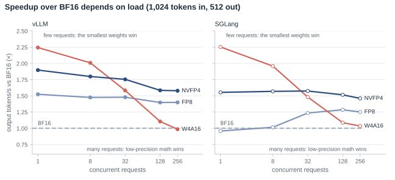
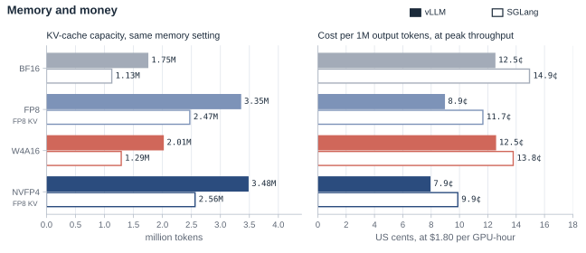
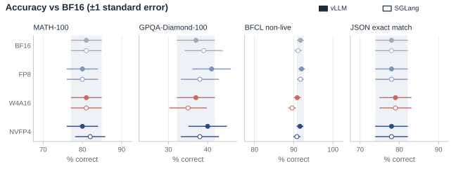

# Serving Qwen3.5-9B in 4 bits: which format and which engine?


[](https://huggingface.co/nyamkhuu)

This study measures what post-training quantization buys when serving
[Qwen3.5-9B](https://huggingface.co/Qwen/Qwen3.5-9B): the BF16 original against **FP8** (W8A8),
**W4A16** (INT4 weights, BF16 compute) and **NVFP4** (FP4 W4A4 in the MLPs, FP8 elsewhere), each served
on **vLLM** and **SGLang**. All eight combinations ran on one NVIDIA RTX PRO 6000 Blackwell (96 GB).

It answers four questions: how fast is it, what does it cost, is it still as accurate, and how smoothly
does it stream? Serving metrics such as TTFT and ITL are defined under [Terms](#terms).



## Contents

- [Key findings](#key-findings)
- [Choosing a format](#choosing-a-format)
  - [Published checkpoints](#published-checkpoints)
- [Background: how quantization helps](#background-how-quantization-helps)
  - [Smaller weights: the model fits](#smaller-weights-the-model-fits)
  - [Smaller KV cache: longer contexts](#smaller-kv-cache-longer-contexts)
  - [Fewer bits per weight: faster tokens](#fewer-bits-per-weight-faster-tokens)
  - [Which GPUs compute in which format](#which-gpus-compute-in-which-format)
  - [What is special about Qwen3.5-9B](#what-is-special-about-qwen35-9b)
- [Study setup](#study-setup)
  - [Hardware and software](#hardware-and-software)
  - [The four variants](#the-four-variants)
  - [Speed and cost benchmark](#speed-and-cost-benchmark)
  - [Accuracy evaluations](#accuracy-evaluations)
  - [Terms](#terms)
- [Results](#results)
  - [1. How fast?](#1-how-fast)
  - [2. How much memory and money?](#2-how-much-memory-and-money)
  - [3. Is it still as accurate?](#3-is-it-still-as-accurate)
  - [4. How smooth is streaming?](#4-how-smooth-is-streaming)
- [Takeaways for serving quantized models](#takeaways-for-serving-quantized-models)
- [Limitations](#limitations)
- [How the checkpoints were made](#how-the-checkpoints-were-made)
- [Reproduce](#reproduce)
  - [Repository layout](#repository-layout)
  - [Explore saved results without a GPU](#explore-saved-results-without-a-gpu)
  - [Serve an existing checkpoint](#serve-an-existing-checkpoint)
  - [One run, end to end](#one-run-end-to-end)
  - [The whole study](#the-whole-study)
  - [Publish a checkpoint](#publish-a-checkpoint)
- [License](#license)

## <a id="the-short-answers"></a>Key findings

| Question | Answer |
|---|---|
| [Which format suits which workload?](#choosing-a-format) | **NVFP4** on Blackwell for many users, **FP8** on Ada and Hopper, **W4A16** for a single user or on older GPUs. |
| [Which GPUs can fit the model?](#smaller-kv-cache-longer-contexts) | **At this study's settings, BF16 needs a 32 GB GPU.** The 4-bit versions fit on 16 GB. On 24 GB, their estimated cache capacity is 230k–370k tokens **shared across active requests**. |
| [How much faster than BF16?](#1-how-fast) | **2.2×** for a single user (W4A16) and **1.58×** at peak load (NVFP4), on vLLM. Which format wins depends on load. |
| [How much cheaper?](#2-how-much-memory-and-money) | **37% lower cost per token** and **2× BF16's KV capacity** with NVFP4 on vLLM. |
| [Is it still as accurate?](#3-is-it-still-as-accurate) | **Similar scores in these tests.** The small reasoning evaluations cannot rule out modest accuracy losses. |
| [vLLM or SGLang?](#4-how-smooth-is-streaming) | **vLLM**: 10–30% higher peak throughput in this study. SGLang's lower p99 token-gap latency hides pauses of up to 2.85 s. |
| [How can the study be reproduced?](#reproduce) | Explore saved results without a GPU, serve a published model, or repeat the eight main runs. Scheduler traces are optional. |

## <a id="pick-a-format"></a>Choosing a format



All runs here were on one Blackwell GPU, so only the Blackwell recommendation is measured. The Ada/Hopper
and older-GPU picks follow from which formats those GPUs compute natively (see
[which GPUs compute in which format](#which-gpus-compute-in-which-format)). On older GPUs W4A16 runs at about
BF16's speed under many requests. What it still gives you is smaller weights and more room for the KV cache.

### Published checkpoints

All three checkpoints are on Hugging Face in compressed-tensors format and run on stock vLLM
(tested with v0.33.0) and SGLang (v0.5.23). Weight memory below is from vLLM. Serving needs additional memory.

| Checkpoint | Weights |
|---|---|
| [`nyamkhuu/Qwen3.5-9B-NVFP4-AWQ-GPTQ`](https://huggingface.co/nyamkhuu/Qwen3.5-9B-NVFP4-AWQ-GPTQ) | 7.6 GiB |
| [`nyamkhuu/Qwen3.5-9B-W4A16-AWQ-GPTQ`](https://huggingface.co/nyamkhuu/Qwen3.5-9B-W4A16-AWQ-GPTQ) | 7.2 GiB |
| [`nyamkhuu/Qwen3.5-9B-FP8`](https://huggingface.co/nyamkhuu/Qwen3.5-9B-FP8) | 10.3 GiB |

No Blackwell GPU? The NVFP4 checkpoint still loads, but it runs weight-only, like W4A16.

With vLLM already installed, serve the NVFP4 checkpoint with:

```bash
vllm serve nyamkhuu/Qwen3.5-9B-NVFP4-AWQ-GPTQ --language-model-only --max-model-len 32768 \
  --reasoning-parser qwen3 --enable-auto-tool-choice --tool-call-parser qwen3_coder \
  --structured-outputs-config.backend=xgrammar
```

For the pinned Docker images, SGLang, and model downloads, see
[serve an existing checkpoint](#serve-an-existing-checkpoint).

## <a id="how-quantization-helps"></a>Background: how quantization helps

Quantization pays off in three ways when serving: smaller weights fit smaller GPUs, a smaller KV cache
holds more concurrent tokens, and fewer bits per weight speed up decoding. How much of the speedup survives
depends on batch size.

### Smaller weights: the model fits

Qwen3.5-9B's weights occupy 16.7 GiB in BF16 and 7.2–7.6 GiB in the tested 4-bit versions. These versions keep
some layers at higher precision, so the whole model does not shrink to one quarter of its original size.
Serving also needs memory for activations, CUDA graphs and the KV cache.

<details>
<summary>Weight-size calculation and serving overhead</summary>

Weight storage in bytes is approximately parameters × bits per weight ÷ 8, plus quantization scales.
The same rule helps estimate larger models: a 32B model is about 60 GiB in BF16, more than a
48 GB card holds, and about 17 GiB in 4 bits, which fits a 24 GB one. Activations and captured CUDA
graphs took about 6 GiB in this study's vLLM runs. At these settings, that leaves the BF16 model no room for a KV cache on a 24 GB GPU.

GPU sizes use the vendors' GB labels. Measured allocations here use GiB (1 GiB = 1,024³ bytes).

</details>

### Smaller KV cache: longer contexts

Smaller weights leave more room for the KV cache, and an FP8 cache halves the bytes per cached token.
Qwen3.5-9B also keeps a fixed-size recurrent state per active request, which
[its architecture](#what-is-special-about-qwen35-9b) explains.

**Cache capacity is a total shared by all active requests.** It does not increase the context limit of an
individual request. The benchmarks use a 32,768-token limit per request, even though the model supports
up to 262,144 tokens:



Only the 96 GB row is measured. The other rows apply the same memory setting and overheads to smaller
GPUs, so treat them as estimates. A higher `--gpu-memory-utilization` or `--enforce-eager` (no CUDA graphs) leaves more room.
For an RTX 5090 (32 GB), the estimate is 4.3× as much total cache capacity with NVFP4 as with BF16:
enough for roughly 22 full 32k-token conversations instead of 5. This was not measured on an RTX 5090.

### Fewer bits per weight: faster tokens

Each decode step streams **all** weights from GPU memory. At small batch sizes decode is
memory-bandwidth-bound, so fewer bits per weight make tokens faster, though by less than the bit count:
W4A16 has a quarter of BF16's bits and is 2.2× faster for one request. At large batch sizes decode becomes
compute-bound, and what counts is whether the matmuls themselves run in low precision.



This explains the [speed results](#1-how-fast). W4A16 has the fewest bits, so it wins at low batch. It
dequantizes to BF16 for the matmul, though, so its lead disappears under load. FP8 and NVFP4 also compute in
low precision and keep their lead.

<details>
<summary>How 4-bit scales work: NVFP4 and MXFP4</summary>

A 4-bit number has only 16 values, so each small group of weights shares a scale that stretches those
values to fit the group. NVFP4 uses groups of 16 with an FP8 scale, plus one FP32 scale per tensor.
MXFP4, the Open Compute Project's format, uses groups of 32 with a power-of-two scale. Smaller groups with
finer scales follow outliers more closely, so NVFP4 usually loses less accuracy at the same 4 bits.

</details>

### Which GPUs compute in which format

Low-precision math needs tensor cores built for it. On older GPUs, vLLM still loads the checkpoint but
runs it weight-only: the weights stay small in memory and are expanded to BF16 for the math by Marlin, a
mixed-precision kernel
([vLLM's support table](https://docs.vllm.ai/en/stable/features/quantization/), and the kernels' capability checks in v0.33.0).

| Format | Math runs in | Native on | On older GPUs |
|---|---|---|---|
| FP8 (W8A8) | FP8 | Ada, Hopper, Blackwell (compute capability 8.9+) | weight-only FP8 via Marlin, from Turing on |
| W4A16 (INT4) | BF16, by design | Turing and newer (Marlin, compute capability 7.5+) | – |
| NVFP4 | FP4 | Blackwell (compute capability 10.0, 12.0) | weight-only FP4 via Marlin, like W4A16 |

### What is special about Qwen3.5-9B

It is a hybrid: only every fourth of its 32 layers uses full attention. The other 24 use
**Gated DeltaNet**, a linear-attention layer with a fixed-size recurrent state per request. An FP8 KV cache
shrinks the attention cache, while that state stays the same size.

<details>
<summary>Layer map, per-token memory calculations, and engine reservations</summary>

The NVFP4 checkpoint, layer by layer:


Per-request memory differs by layer type: attention layers keep a KV cache that grows with every token,
and DeltaNet layers keep a fixed-size state. So the KV cache costs only 32 KiB per token in BF16, where all
32 layers would need 128 KiB. The calculation is 8 layers × 4 KV heads × 256 dimensions × 2 (keys and values)
= 16,384 numbers per token: **32 KiB in BF16, 16 KiB in FP8**. At the model's full 262,144-token context,
that is 8 GiB in BF16 or 4 GiB in FP8. The 24 DeltaNet layers add about 48 MiB per request regardless of
context length (24 layers × 32 heads × 128 × 128 numbers in FP32):



The DeltaNet state is FP32 in every variant, BF16 included. The model's `config.json` sets
`mamba_ssm_dtype` to `float32`, and both engines follow it ([vLLM](https://github.com/vllm-project/vllm/blob/4ba787ec9959e566d3b587a796dff07673324da5/vllm/model_executor/models/config.py#L953-L978),
[SGLang](https://github.com/sgl-project/sglang/blob/297e54fd105e974cdf401e5b4d20253a22c16f90/python/sglang/srt/configs/mamba_utils.py#L71-L92)).
An FP8 KV cache halves the part that grows and leaves the state as it is.

The chart shows what the model needs, and the engines reserve more. SGLang reserves room for 5 states per request
(its log: 34.4 GiB of state for 146 requests). vLLM's single memory pool holds the states too, so it costs 37 and
21 KiB per token of capacity rather than 32 and 16.

</details>

## Study setup



### Hardware and software

| Setting | Value |
|---|---|
| GPU | One NVIDIA RTX PRO 6000 Blackwell, 96 GB |
| Engines | vLLM v0.33.0 and SGLang v0.5.23, from pinned Docker images ([commands](#serve-an-existing-checkpoint)) |
| Memory setting | 0.88 on both engines, which does not give them equal KV-cache budgets ([why](#2-how-much-memory-and-money)) |
| Context limit | 32,768 tokens per request (the model supports 262,144) |
| KV-cache format | `auto`, so it follows the checkpoint: FP8 for FP8 and NVFP4, BF16 otherwise |
| Repetitions | One run per model-and-engine combination |

### The four variants

Each compressed version keeps some parts at higher precision. The
[recipes](#how-the-checkpoints-were-made) list the exact choices.

| Variant | Weights | Math runs in | Weight memory on vLLM |
|---|---|---|---|
| BF16 (original) | 16-bit floating point | BF16 | 16.71 GiB |
| FP8 | 8-bit floating point, one scale per channel | FP8 | 10.29 GiB |
| W4A16 | 4-bit integers, one scale per group of 128 weights | BF16 | 7.20 GiB |
| NVFP4 | 4-bit floating point in the MLPs except the last 4, FP8 in attention and DeltaNet layers | FP4 in the NVFP4 MLPs, FP8 elsewhere | 7.64 GiB |

### Speed and cost benchmark

[`bench/sweep.sh`](bench/sweep.sh) load-tests each server with `vllm bench serve`. Every request has 1,024
random tokens in and exactly 512 out, so there is no prefix caching and no early stop. The sweep keeps 1, 8,
32, 128 and 256 requests in flight, with 8 prompts per slot (at least 32, at most 1,024), while `nvidia-smi`
samples memory and power. Cost and energy per token use each combination's peak throughput, as explained
in [section 2](#2-how-much-memory-and-money).

### Accuracy evaluations

Four suites run identically on every variant and engine ([`evals/run_evals.py`](evals/run_evals.py)).
Reasoning suites run with thinking on and the model card's sampling settings. Tool-calling and JSON suites
decode greedily. JSON is tested both free and schema-constrained (the server's grammar-constrained decoding).

| Suite | Tests | Setup |
|---|---|---|
| **MATH-100** | competition math, 100 of MATH-500 (seeded) | thinking on, the model card's sampling settings, graded with math-verify |
| **GPQA-Diamond-100** | graduate-level science multiple choice | thinking on, the model card's sampling settings |
| **BFCL v3 non-live** | tool calling: simple, multiple, parallel, parallel-multiple (1,000) | native tool calls, greedy |
| **JSON mode** | [json-mode-eval](https://huggingface.co/datasets/NousResearch/json-mode-eval), free and schema-constrained (100 each) | greedy, scored on parse rate, schema validity and exact match |

For MATH and GPQA, generation, including thinking, is capped at 16,384 tokens. Tool-calling and JSON
answers are capped at 2,048 tokens.

<details>
<summary>Why the JSON tests pin vLLM's structured-output backend</summary>

The JSON numbers need vLLM's structured-output backend pinned. With the default `auto`, vLLM uses one
backend per engine, set by the first structured-output request, and rejects later requests that resolve to
another ([source](https://github.com/vllm-project/vllm/blob/4ba787ec9959e566d3b587a796dff07673324da5/vllm/v1/structured_output/__init__.py#L133-L193)).
Depending on request order, 1 or 99 of the 100 JSON-mode requests failed that way. Every vLLM run
here therefore uses `--structured-outputs-config.backend=xgrammar`. SGLang already defaults to xgrammar.

</details>

### Terms

| Term | Meaning |
|---|---|
| **KV cache** | The attention keys and values of every token so far, kept per request so decode steps don't recompute them. It grows with every token, so it dominates per-request memory at long contexts. |
| **Prefill, decode** | The two phases of a request: one forward pass over the whole prompt, then one step per output token. |
| **Concurrency** | Requests kept in flight at once ("c=32" means 32). The engine batches them together. |
| **Weight-only** | Weights stored in low precision and dequantized to BF16 for the matmul. Saves memory and bandwidth, not compute. |
| **TTFT** | Time to first token: queueing plus prefill. |
| **TPOT** | Time per output token after the first. |
| **ITL** | Inter-token latency: each gap between two streamed chunks, one token each with default settings. Its tail shows stalls. |
| **E2E** | End-to-end latency: from sending the request to its last token. |
| **p95 / p99** | Percentiles over all measurements pooled across requests. The slowest 1% can be much worse than p99. |

## Results

### 1. How fast?



**The best format depends on how many requests share the GPU.**

- **One request:** W4A16 is **2.2× faster** than BF16 on vLLM (185 against 82 tokens/s) and 2.3× on
  SGLang, then NVFP4 at 1.9×. These are the smallest weights.
- **256 requests:** NVFP4 is **1.58× faster** on vLLM (6,320 against 4,004 tokens/s) and FP8 1.4×, while
  W4A16 falls back to BF16's speed. Expanding 4-bit weights to BF16 inside the Marlin kernel becomes the
  bottleneck.
- **One anomaly:** FP8 on SGLang gives no speedup at 1 or 8 requests (81 tokens/s against 84 for BF16 with
  one request, and 126 for FP8 on vLLM). It helps only from 32 requests on, and lifts SGLang's peak by 28%.
  SGLang runs these per-channel FP8 layers through a CUTLASS kernel whose tiles are not tuned for small
  batches on this GPU family. An open pull request measures the same gap on an RTX PRO 5000 (138 against
  vLLM's 218 tokens/s for one request) and closes it with tuned tiles
  ([sgl-project/sglang#49275](https://github.com/sgl-project/sglang/pull/49275)).

vLLM reaches a 10–30% higher peak than SGLang in every variant. SGLang levels off at 128–147 requests.
Its log shows the DeltaNet state cache capping running requests there (it keeps room for 5 states per
request), so 256 requests only add queueing.

<details>
<summary>Throughput table (output tokens/s)</summary>

| Variant | Engine | c=1 | c=8 | c=32 | c=128 | c=256 |
|---|---|---|---|---|---|---|
| BF16 | vLLM | 82 | 609 | 1,787 | 3,610 | **4,004** |
| BF16 | SGLang | 84 | 603 | 1,750 | 3,340 | 3,346 |
| FP8 | vLLM | 126 | 899 | 2,642 | 5,044 | **5,602** |
| FP8 | SGLang | 81 | 612 | 2,162 | **4,293** | 4,186 |
| W4A16 | vLLM | 185 | 1,224 | 2,828 | **3,988** | 3,944 |
| W4A16 | SGLang | 190 | 1,180 | 2,592 | **3,626** | 3,461 |
| NVFP4 | vLLM | 156 | 1,095 | 3,135 | 5,721 | **6,320** |
| NVFP4 | SGLang | 131 | 945 | 2,755 | **5,062** | 4,887 |

</details>

<details>
<summary>Latency tables by concurrency</summary>

One request (milliseconds):

| Variant | Engine | TTFT | TPOT |
|---|---|---|---|
| BF16 | vLLM | 71.8 | 12.01 |
| BF16 | SGLang | 69.4 | 11.76 |
| FP8 | vLLM | 67.9 | 7.84 |
| FP8 | SGLang | 53.2 | 12.31 |
| W4A16 | vLLM | 73.9 | 5.27 |
| W4A16 | SGLang | 71.4 | 5.14 |
| NVFP4 | vLLM | 77.2 | 6.26 |
| NVFP4 | SGLang | 52.2 | 7.55 |

32 concurrent requests. Each pair is p95 / p99:

| Variant | Engine | TTFT (ms) | TPOT (ms) | End-to-end (s) |
|---|---|---|---|---|
| BF16 | vLLM | 1198 / 1287 | 17.56 / 18.04 | 9.45 / 9.64 |
| BF16 | SGLang | 1425 / 1433 | 18.05 / 18.26 | 9.52 / 9.52 |
| FP8 | vLLM | 744 / 890 | 11.60 / 11.84 | 6.31 / 6.42 |
| FP8 | SGLang | 921 / 929 | 14.57 / 14.69 | 7.68 / 7.69 |
| W4A16 | vLLM | 1479 / 1545 | 10.66 / 11.37 | 6.11 / 6.18 |
| W4A16 | SGLang | 1586 / 1598 | 12.11 / 12.36 | 6.51 / 6.51 |
| NVFP4 | vLLM | 592 / 749 | 9.70 / 9.82 | 5.31 / 5.36 |
| NVFP4 | SGLang | 750 / 771 | 11.44 / 11.46 | 6.05 / 6.05 |

128 concurrent requests:

| Variant | Engine | TTFT p95 / p99 (ms) | ITL p99 (ms) |
|---|---|---|---|
| BF16 | vLLM | 2648 / 3696 | 342 |
| BF16 | SGLang | 5527 / 5593 | 30 |
| FP8 | vLLM | 2266 / 3411 | 193 |
| FP8 | SGLang | 3606 / 3678 | 25 |
| W4A16 | vLLM | 3362 / 4508 | 384 |
| W4A16 | SGLang | 6206 / 6338 | 25 |
| NVFP4 | vLLM | 1804 / 2713 | 153 |
| NVFP4 | SGLang | 2883 / 2973 | 21 |

Every recorded percentile of TTFT, TPOT, ITL and E2E at every concurrency is in
`results/bench/<run>/perf/c<N>.json`.

</details>

### 2. How much memory and money?



Smaller weights leave more memory for the KV cache, and an FP8 cache stores each token in half the bytes.
NVFP4 and W4A16 have weights of about the same size, yet NVFP4, with its FP8 cache, fits **1.7× as many
tokens** on vLLM, where the KV cache shares one memory pool with the DeltaNet state. SGLang keeps a separate KV
pool and gets the full 2.0×. The benchmark (1,024 tokens in, 512 out) never filled the cache. Capacity
starts to matter with long reasoning, such as the 16k-token evaluations.

Cost is the GPU-hour price divided by the tokens made per hour at peak throughput, on a fully loaded GPU.
$1.80 is near the low end of on-demand RTX PRO 6000 prices (9 providers, $1.70–5.50, mean $3.27 in November
2026, per [Thunder Compute](https://www.thundercompute.com/blog/nvidia-rtx-pro-6000-pricing)). Costs scale
with the price, but the relative savings between formats do not depend on it. NVFP4 also makes **1.7× as many tokens per
joule** as BF16.

> [!NOTE]
> **The two engines are not compared at equal KV budgets.** Both got a memory setting of 0.88, but vLLM's
> `--gpu-memory-utilization` budgets everything, CUDA graphs included
> ([source](https://github.com/vllm-project/vllm/blob/4ba787ec9959e566d3b587a796dff07673324da5/vllm/v1/worker/gpu_worker.py#L707-L757), peak about 84 GiB), while SGLang's
> `--mem-fraction-static` covers weights and memory pools, with activations and CUDA graphs on top
> ([source](https://github.com/sgl-project/sglang/blob/297e54fd105e974cdf401e5b4d20253a22c16f90/python/sglang/srt/arg_groups/memory_hook.py#L58-L61), peak about 93 GiB). vLLM also shares one pool between the
> KV cache and the DeltaNet state, while SGLang keeps them apart.

<details>
<summary>Memory, cost and energy tables</summary>

| Variant | Engine | Weights | KV + DeltaNet state pool | KV capacity (tokens) | Max running requests | Peak device memory |
|---|---|---|---|---|---|---|
| BF16 | vLLM | 16.71 GiB | 61.8 GiB (shared) | 1,746,137 | – | 83.7 GiB |
| FP8 | vLLM | 10.29 GiB | 67.9 GiB (shared) | 3,348,070 | – | 84.5 GiB |
| W4A16 | vLLM | 7.20 GiB | 71.3 GiB (shared) | 2,013,246 | – | 83.7 GiB |
| NVFP4 | vLLM | 7.64 GiB | 70.5 GiB (shared) | 3,475,865 | – | 84.6 GiB |
| BF16 | SGLang | 17.62 GiB | KV 34.4 + state 30.9 GiB | 1,126,073 | 128 | 93.1 GiB |
| FP8 | SGLang | 11.19 GiB | KV 37.7 + state 33.9 GiB | 2,472,435 | 141 | 93.5 GiB |
| W4A16 | SGLang | 8.14 GiB | KV 39.4 + state 35.4 GiB | 1,289,473 | 147 | 94.2 GiB |
| NVFP4 | SGLang | 8.58 GiB | KV 39.1 + state 35.2 GiB | 2,562,979 | 146 | 92.6 GiB |

| Variant | Engine | Peak output tokens/s | ¢ per 1M output tokens | Mean power | Output tokens per joule |
|---|---|---|---|---|---|
| BF16 | vLLM | 4,004 | 12.5 | 503 W | 7.95 |
| BF16 | SGLang | 3,346 | 14.9 | 459 W | 7.29 |
| FP8 | vLLM | 5,602 | 8.9 | 497 W | 11.27 |
| FP8 | SGLang | 4,293 | 11.7 | 428 W | 10.04 |
| W4A16 | vLLM | 3,988 | 12.5 | 493 W | 8.08 |
| W4A16 | SGLang | 3,626 | 13.8 | 467 W | 7.77 |
| NVFP4 | vLLM | **6,320** | **7.9** | 470 W | **13.46** |
| NVFP4 | SGLang | 5,062 | 9.9 | 417 W | 12.15 |

SGLang's weight figure is about 0.9 GiB higher in every variant because it also loads the vision tower, which
it won't skip for Qwen3.5: about 0.46B parameters, or 0.85 GiB in BF16, by the model's config.

</details>

### 3. Is it still as accurate?



**Scores were similar in these tests, but the small reasoning evaluations cannot rule out modest
accuracy losses.** W4A16 on SGLang has the lowest BFCL score: 89.6% against BF16's 91.1%, with most of
the gap in parallel-call categories. JSON parses at least 98% of the time everywhere.
The [accuracy evaluations](#accuracy-evaluations) describe each suite.

**GPQA is strongly affected by the output limit.** Generation, including thinking, is capped at 16,384
tokens, so 56–62% of GPQA answers are cut off and count as wrong. These scores compare the variants under
the same limit. They should not be compared directly with published scores from other evaluation setups.

All scores below are percentages. JSON exact match means the output equals the reference answer.

| Variant | Engine | MATH-100 | GPQA-D-100 | BFCL | JSON exact (free) |
|---|---|---|---|---|---|
| BF16 | vLLM | 81 | 37 | 91.7 | 78 |
| BF16 | SGLang | 81 | 39 | 91.1 | 78 |
| FP8 | vLLM | 80 | 41 | 92.0 | 78 |
| FP8 | SGLang | 80 | 38 | 91.7 | 78 |
| W4A16 | vLLM | 81 | 37 | 90.9 | 79 |
| W4A16 | SGLang | 81 | 35 | 89.6 | 79 |
| NVFP4 | vLLM | 80 | 40 | 91.6 | 78 |
| NVFP4 | SGLang | 82 | 38 | 90.8 | 78 |

Standard error is about ±4–5 percentage points for the 100-question reasoning tests and ±0.9 points
for BFCL (1,000 questions). The differences are within noise, but the tests are too small to establish
equivalence.

<details>
<summary>Reasoning answers cut off at the token limit</summary>

Counts out of 100 questions in each suite:

| Variant | Engine | MATH cut off | GPQA cut off |
|---|---|---|---|
| BF16 | vLLM | 19 | 62 |
| BF16 | SGLang | 19 | 58 |
| FP8 | vLLM | 20 | 56 |
| FP8 | SGLang | 20 | 59 |
| W4A16 | vLLM | 19 | 60 |
| W4A16 | SGLang | 19 | 62 |
| NVFP4 | vLLM | 20 | 58 |
| NVFP4 | SGLang | 18 | 58 |

</details>

<details>
<summary>Tool-calling accuracy by BFCL category (%)</summary>

Simple tests offer one function. Multiple tests offer a choice of functions. Parallel tests require
multiple calls, and parallel-multiple tests combine both conditions.

| Variant | Engine | Simple | Multiple | Parallel | Parallel-multiple |
|---|---|---|---|---|---|
| BF16 | vLLM | 94.2 | 93.5 | 86.5 | 90.0 |
| BF16 | SGLang | 94.2 | 92.5 | 85.5 | 89.0 |
| FP8 | vLLM | 94.8 | 94.5 | 86.0 | 90.0 |
| FP8 | SGLang | 94.2 | 95.0 | 85.0 | 90.0 |
| W4A16 | vLLM | 94.0 | 92.0 | 85.0 | 89.5 |
| W4A16 | SGLang | 93.0 | 92.0 | 82.5 | 87.5 |
| NVFP4 | vLLM | 94.8 | 94.5 | 85.0 | 89.0 |
| NVFP4 | SGLang | 93.2 | 94.5 | 85.0 | 88.0 |

</details>

<details>
<summary>JSON parsing, schema validity, and exact match (%)</summary>

Free generation:

| Variant | Engine | Parsed | Schema valid | Exact match |
|---|---|---|---|---|
| BF16 | vLLM | 100 | 99 | 78 |
| BF16 | SGLang | 100 | 99 | 78 |
| FP8 | vLLM | 100 | 99 | 78 |
| FP8 | SGLang | 100 | 99 | 78 |
| W4A16 | vLLM | 100 | 100 | 79 |
| W4A16 | SGLang | 100 | 100 | 79 |
| NVFP4 | vLLM | 100 | 99 | 78 |
| NVFP4 | SGLang | 100 | 99 | 78 |

Schema-constrained generation:

| Variant | Engine | Schema valid | Exact match |
|---|---|---|---|
| BF16 | vLLM | 99 | 77 |
| BF16 | SGLang | 98 | 76 |
| FP8 | vLLM | 99 | 77 |
| FP8 | SGLang | 98 | 76 |
| W4A16 | vLLM | 99 | 78 |
| W4A16 | SGLang | 98 | 77 |
| NVFP4 | vLLM | 99 | 79 |
| NVFP4 | SGLang | 98 | 77 |

</details>

### <a id="4-why-p99-hides-the-worst-stalls"></a>4. How smooth is streaming?

**A pooled p99 can hide a long pause that almost every request sees.** If each request has one long gap
among hundreds of short ones, those gaps are well under 1% of the pool. The worst gap per request shows them.

At 128 concurrent requests, vLLM's p99 inter-token latency is 153–384 ms and SGLang's only 21–30 ms,
which makes SGLang look smoother. A per-step scheduler trace on NVFP4, recorded inside each engine
next to the client's per-token timestamps, shows the opposite picture. Both engines stall running
requests while new prompts are prefilled. vLLM mixes work on new prompts with decoding for running
requests. With the tested defaults, SGLang processes new prompts separately, so running requests wait.

<details>
<summary>Scheduler settings and source references</summary>

- vLLM's scheduler has no separate prefill phase: each step it first schedules every running request, then
  fills what is left of an 8,192-token budget (its default on GPUs of 70 GiB and more) with new prompts
  ([scheduler](https://github.com/vllm-project/vllm/blob/4ba787ec9959e566d3b587a796dff07673324da5/vllm/v1/core/sched/scheduler.py#L699-L719),
  [default](https://github.com/vllm-project/vllm/blob/4ba787ec9959e566d3b587a796dff07673324da5/vllm/engine/arg_utils.py#L2983-L2992)).
- SGLang runs a prefill batch first whenever new requests can be admitted, and mixes no decoding into it
  unless `--enable-mixed-chunk` is set. Prefill comes in 8,192-token chunks on this GPU size
  ([scheduler](https://github.com/sgl-project/sglang/blob/297e54fd105e974cdf401e5b4d20253a22c16f90/python/sglang/srt/managers/scheduler.py#L3990-L4006), [mixed chunks](https://github.com/sgl-project/sglang/blob/297e54fd105e974cdf401e5b4d20253a22c16f90/python/sglang/srt/arg_groups/fields/schedule.py#L208-L211),
  [chunk size](https://github.com/sgl-project/sglang/blob/297e54fd105e974cdf401e5b4d20253a22c16f90/python/sglang/srt/arg_groups/memory_hook.py#L132-L159)).

Both server logs confirm the budgets: "max_num_batched_tokens=8192" and "chunked_prefill_size=8192".

</details>

New prompts arrive in waves: every output is exactly 512 tokens, so requests that start together finish
together, and the benchmark replaces them at once (vLLM spreads its waves out, because it reads new
prompts 7 per step). The animation replays one wave from the step traces and follows one new request,
from its prefill step to its decode steps. Its prompt is prefilled early in the wave, so on SGLang it waits
almost the longest.


- **vLLM** packs up to 7 new 1,024-token prompts into the same step as about 100 running requests. Those
  steps take 152 ms instead of 17 ms: many short gaps, enough to set the p99.
- **SGLang** runs prefill as separate 8,192-token batches, back to back, about 2.9 s per wave of new
  requests, and decoding waits. Almost every request (97%) gets one long gap (median 1.35 s, up to 2.85 s), but
  those are only 0.2% of all gaps, so the p99 never sees them.


The left panel follows one request from the middle of the run. All three streams have 33–37 tokens after
3 s, but SGLang's arrive only after 2.4 s of silence, a longer stall than the median request's 1.35 s. On
the right, SGLang's p99 (21 ms) is 64× shorter than the worst gap of its median request (1,350 ms), while
vLLM's two numbers agree.

| NVFP4, c=128 | vLLM (default 8,192 tokens/step) | vLLM `--max-num-batched-tokens 2048` | SGLang (default) |
|---|---|---|---|
| decode-only step / step with prefill | 17 ms / **152 ms** | 17 ms / 78 ms | 19 ms / 181 ms |
| ITL mean / p99 / p99.9 / max | 20.9 / 153 / 158 / **163** ms | 30.4 / 87 / 91 / 99 ms | 22.1 / **21** / 1,309 / **2,847** ms |
| worst gap per request (median) | 158 ms | 90 ms | **1,350 ms** |
| output tokens/s / p99 TTFT | 5,738 / 2.6 s | 3,963 / 9.0 s | 5,061 / 2.9 s |

Shrinking vLLM's per-step token budget to 2,048 removes every gap over 100 ms, but it costs 31% of
throughput and raises p99 TTFT 3.5×, so the default is the better trade here. For a fair comparison of
streaming smoothness, measure **the worst gap per request**, not only p99.

## <a id="lessons-for-serving-quantized-models"></a>Takeaways for serving quantized models

1. **Choose the format by load.** The fastest format for one user (W4A16) is no faster than BF16 at full
   load, and the best at full load (NVFP4) comes second for one user.
2. **On hybrid models, read KV capacity per engine.** An FP8 cache gave 2.0× the tokens on SGLang but 1.7× on
   vLLM, whose pool also holds the DeltaNet state.
3. **Equal memory flags are not equal budgets across engines.** vLLM and SGLang count different things
   with the same 0.88.
4. **Pin vLLM's structured-output backend.** With `auto`, 1 or 99 of the 100 JSON-mode requests failed,
   depending on request order ([details](#accuracy-evaluations)).
5. **Look past p99.** SGLang's smooth p99 hid a stall in 97% of requests, longer than 1 s in 61% of them.

## <a id="caveats"></a>Limitations

- One run per configuration, on one GPU type with one version of each engine.
- The engines ran at the same nominal memory setting, not an equal KV-cache budget.
- Random-token prompts with a fixed output length: no prefix caching, no early stops.
- n=100 for MATH and GPQA, and GPQA is limited by the 16k thinking cap.
- Speculative decoding with the model's multi-token-prediction head was not used.
- The in-engine hook behind the step traces is not published, since it patches private engine
  classes. Server logs, GPU samples, and per-request outputs are not published either. What this means for
  reproduction is described in [Reproduce](#reproduce).

## How the checkpoints were made

**Rounding.** Round-to-nearest loses too much at 4 bits, so two calibration-based methods are stacked.
**AWQ** first rescales the input channels with the largest activations so their weights lose less
precision. **GPTQ** then quantizes one column at a time and updates the remaining columns to compensate,
using second-order statistics of the calibration activations.

**Calibration data** ([`quantize/build_calib.py`](quantize/build_calib.py)). Since GPTQ fits its rounding to
this data, it should look like real traffic. The BF16 model writes half of the set itself, and everything is
rendered with Qwen3.5's chat template, so `<think>` blocks and tool-call markup appear as they do in serving:

| Samples | Source | Content |
|---|---|---|
| 800 | [NuminaMath-1.5](https://huggingface.co/datasets/project-numina/NuminaMath-1.5) (non-MATH sources), [OpenCodeReasoning](https://huggingface.co/datasets/nvidia/OpenCodeReasoning) | reasoning traces written by the model, thinking on |
| 400 | [hermes-function-calling-v1](https://huggingface.co/datasets/NousResearch/hermes-function-calling-v1) | tool calls written by the model, half with thinking |
| 512 | [ultrachat_200k](https://huggingface.co/datasets/HuggingFaceH4/ultrachat_200k) | multi-turn chat |
| 336 | [neuralmagic/calibration](https://huggingface.co/datasets/neuralmagic/calibration) | instructions, STEM, code |

The 2,048 samples hold 7.3M tokens (median 1,655). The 4-bit runs used the first 256 (about 0.9M tokens,
still about 70× the width of the largest layer). At 512 samples, AWQ's activation caches no longer fit in
96 GB, and moving them to the CPU was about 35% slower. FP8 used 512 samples, since only its KV-cache
scales need data.

**Recipes** ([`quantize/quantize.py`](quantize/quantize.py)), adapted from llm-compressor's official
Qwen3.5 examples to 32 layers:

| Variant | Recipe |
|---|---|
| FP8 | FP8 weights (one scale per channel) and activations (one scale per token, computed at run time) in the language model's linear layers, except `lm_head` and the small DeltaNet gates listed below; calibrated FP8 KV-cache scales |
| W4A16 | AWQ, then GPTQ: INT4, symmetric, one scale per group of 128 weights |
| NVFP4 | AWQ, then GPTQ: MLPs in NVFP4, with attention and DeltaNet layers, the output layer (`lm_head`) and the last 4 MLPs in FP8, plus calibrated FP8 KV-cache scales |

Every variant keeps the vision tower, embeddings, DeltaNet's small gate layers and short convolution (`conv1d`),
norms and the multi-token-prediction head in BF16.
The output layer (`lm_head`) also stays in BF16 for FP8 and W4A16. NVFP4 quantizes it to FP8.

## Reproduce

Choose the path that matches what you want to do. Run commands from the repository root.

| Goal | Start here | What you need |
|---|---|---|
| Read results or redraw the generated charts | [Explore saved results](#explore-saved-results-without-a-gpu) | Python and uv, no GPU |
| Use a published quantized model | [Serve an existing checkpoint](#serve-an-existing-checkpoint) | A compatible NVIDIA GPU, driver, and Docker |
| Measure an existing checkpoint | [One run, end to end](#one-run-end-to-end) | Server setup plus the Python client environment |
| Repeat calibration, quantization, and the eight main runs | [The whole study](#the-whole-study) | The study's 96 GB Blackwell GPU setup and about 100 GB of disk |
| Publish your own checkpoint | [Publish a checkpoint](#publish-a-checkpoint) | A quantized checkpoint and a Hugging Face account |

The main benchmarks, evaluations, and summary can be regenerated with the published code. **Scheduler
traces are optional.** The saved summary includes the original trace measurements, so all four generated
charts can be redrawn without the raw trace files.

### Repository layout

| Path | Purpose |
|---|---|
| `quantize/` | calibration set, the three recipes, Hugging Face model cards |
| `bench/sweep.sh` | the concurrency sweep with GPU sampling |
| `evals/run_evals.py` | MATH, GPQA, BFCL and JSON-mode evals |
| `report/` | raw runs → `results/summary.json` → `docs/figures/` |
| `results/summary.json` | combined benchmark, evaluation, calibration, and trace measurements from the original study |
| `results/bench/<run>/` | per run: `perf/c<N>.json`, `evals/evals_summary.json` |
| `docs/figures/` | four generated charts, plus the `diagram_*.svg` illustrations, which are maintained by hand |

### Explore saved results without a GPU

With [uv](https://docs.astral.sh/uv/) installed, redraw the four generated charts from the committed summary:

```bash
uv run --only-group report python report/figures.py
```

This writes `speedup.svg`, `capacity_cost.svg`, `accuracy.svg`, and `stalls.svg` to `docs/figures/`.
The `--only-group report` environment avoids installing the GPU and quantization dependencies.

The saved `results/summary.json` contains the combined measurements. `results/bench/<run>/perf/c<N>.json`
and `evals/evals_summary.json` contain the published per-run results. This path reads the existing study,
so it does not run benchmarks or replace those results.

### Serve an existing checkpoint

For the Docker commands below, install Docker with the NVIDIA Container Toolkit and use an NVIDIA driver
580+ (CUDA 13.0). Choose a GPU with enough memory for the weights, cache, and serving overhead. The
[capacity estimates](#smaller-kv-cache-longer-contexts) explain smaller GPUs. **96 GB is the hardware used
for the study, not a requirement for every serving configuration**. Native NVFP4 computation needs Blackwell.

Set the pinned engine images, model, and output directory. This example downloads the published NVFP4
checkpoint automatically when the server starts:

```bash
VLLM=vllm/vllm-openai:v0.33.0@sha256:d825baf9ce4b1b6bfc5ecc7b79880c7e6748c65a72d697ce3d47607aafa84c6e
SGLANG=lmsysorg/sglang:v0.5.23-cu130@sha256:f832b5c39559c9caa900b22ad37c76fcce66470676855c42052102c537812f1f
MODEL=nyamkhuu/Qwen3.5-9B-NVFP4-AWQ-GPTQ
OUT=results/bench/q35_9b_nvfp4_vllm
mkdir -p "$OUT" data/hf-cache
```

Start **one** engine. For vLLM:

```bash
docker run --rm --gpus all --ipc=host --network host -v "$PWD":/work -w /work \
  -v "$PWD/data/hf-cache":/root/.cache/huggingface \
  --entrypoint vllm "$VLLM" serve "$MODEL" --served-model-name m \
  --max-model-len 32768 --gpu-memory-utilization 0.88 --language-model-only \
  --reasoning-parser qwen3 --enable-auto-tool-choice --tool-call-parser qwen3_coder \
  --structured-outputs-config.backend=xgrammar 2>&1 | tee "$OUT/server.log"
```

For SGLang, first set `OUT=results/bench/q35_9b_nvfp4_sglang` and run `mkdir -p "$OUT"`, then:

```bash
docker run --rm --gpus all --ipc=host --network host -v "$PWD":/work -w /work \
  -v "$PWD/data/hf-cache":/root/.cache/huggingface \
  --entrypoint python3 "$SGLANG" -m sglang.launch_server --model-path "$MODEL" --served-model-name m \
  --port 8000 --context-length 32768 --mem-fraction-static 0.88 \
  --reasoning-parser qwen3 --tool-call-parser qwen3_coder 2>&1 | tee "$OUT/server.log"
```

Both commands also accept a local checkpoint path as `MODEL`, relative to the repository root. Keep
models inside the mounted repository directory. If `data/` is a symlink to another disk, mount its actual
location into the container at `/work/data` as well.

The server is ready when `curl -s localhost:8000/v1/models` returns the model list. The model is exposed
as `m` at `http://localhost:8000/v1`. Stop the server with Ctrl+C before switching engines.

<details>
<summary>Why these server flags</summary>

- `--language-model-only` skips the vision tower on vLLM. SGLang 0.5.23 rejects this flag for Qwen3.5.
- `--structured-outputs-config.backend=xgrammar` avoids vLLM's backend lock-in, described under
  [accuracy evaluations](#accuracy-evaluations). xgrammar is also SGLang's default.
- The KV-cache dtype stays at `auto`, so it follows the checkpoint.
- `tee` saves the server log, which `report/summary.py` reads the memory numbers from.
- The Docker cache mount keeps downloaded models available after the container exits.

</details>

### One run, end to end

A run consists of a server, a concurrency sweep, and accuracy evaluations. To repeat the study's settings,
use its 96 GB GPU setup. Besides the server requirements above, the client and quantization environment
needs x86_64 Linux, Python 3.12, uv, a C compiler, Python headers, and a CUDA build environment for
`causal-conv1d`. Allow about 100 GB of disk for the complete study's models and working files.

**Prepare the environment and download the models before starting the server:**

```bash
sudo apt-get install -y python3.12-dev build-essential   # causal-conv1d compiles against PyTorch
uv sync --frozen
uv run hf download Qwen/Qwen3.5-9B --local-dir data/models/Qwen3.5-9B
uv run hf download nyamkhuu/Qwen3.5-9B-NVFP4-AWQ-GPTQ --local-dir data/models/Qwen3.5-9B-NVFP4
```

The benchmark client uses the BF16 model's tokenizer even when testing a quantized model, so keep the
BF16 download. Skip the NVFP4 download if you already created that checkpoint locally.

**Terminal 1:** set the image variables from [the server setup](#serve-an-existing-checkpoint), then set
these run variables and start the chosen engine with its command above:

```bash
MODEL=data/models/Qwen3.5-9B-NVFP4
OUT=results/bench/q35_9b_nvfp4_vllm
mkdir -p "$OUT"
```

For SGLang, change the output directory's suffix to `_sglang`. For other formats, change both `MODEL`
and `OUT` so each model-and-engine combination has its own results directory.

**Terminal 2:** set `OUT` to the same directory as Terminal 1. Once the server is ready, run:

```bash
OUT=results/bench/q35_9b_nvfp4_vllm   # use the matching _sglang directory for SGLang
bash bench/sweep.sh "$OUT/perf"
uv run python evals/run_evals.py --out "$OUT/evals"
```

Then stop the server with Ctrl+C before starting the next run. Results go to `perf/c<N>.json` and
`evals/evals_summary.json` under `OUT`. Full evaluation responses are saved in `evals/<suite>.jsonl`.

<details>
<summary>What each command does</summary>

- `bench/sweep.sh` runs the [speed and cost benchmark](#speed-and-cost-benchmark): `vllm bench serve` at
  each concurrency, while `nvidia-smi` samples memory and power.
- `run_evals.py` runs all suites at once through 256 request slots so the server stays busy while long
  thinking answers finish. It exits with an error if a request failed for a reason other than the
  server rejecting it. Rerun only those suites with `--suites`.

</details>

### The whole study

Use the environment setup and BF16 download above. To create your own checkpoints, start with calibration.
There is no need to download the published NVFP4 checkpoint for this path.

**1. Build the calibration set.** Serve BF16 on vLLM with `MODEL=data/models/Qwen3.5-9B` and
`OUT=data/calib_server`, and create that output directory before starting the server. Once it is ready, the
script has the model write reasoning traces and tool calls, then mixes in the public data:

```bash
mkdir -p results/calib
uv run python quantize/build_calib.py --model data/models/Qwen3.5-9B --out data/calib.jsonl \
  > results/calib/stats.json
```

**2. Quantize.** Stop the calibration server first: quantization uses the whole GPU. Run the recipes one
at a time:

```bash
uv run python quantize/quantize.py --scheme fp8 --num-samples 512 \
  --model data/models/Qwen3.5-9B --calib data/calib.jsonl --out data/models/Qwen3.5-9B-FP8
uv run python quantize/quantize.py --scheme w4a16 \
  --model data/models/Qwen3.5-9B --calib data/calib.jsonl --out data/models/Qwen3.5-9B-W4A16
uv run python quantize/quantize.py --scheme nvfp4 \
  --model data/models/Qwen3.5-9B --calib data/calib.jsonl --out data/models/Qwen3.5-9B-NVFP4
```

**3. Run the eight combinations.** Follow [one run, end to end](#one-run-end-to-end) for BF16, FP8, W4A16,
and NVFP4 on each engine. Name the output directories
`results/bench/q35_9b_<bf16|fp8|w4a16|nvfp4>_<vllm|sglang>`.

**4. Generate the summary and charts.** Each run's `perf/c<N>.json` contains throughput and latency
measurements, and `evals/evals_summary.json` contains accuracy scores, truncation counts, and errors.
Keep `server.log`, `perf/gpu_samples.csv`, and `perf/phases.txt` for memory and power calculations.
After completing the eight main runs and calibration, run:

```bash
uv run python report/summary.py
uv run --only-group report python report/figures.py
```

These commands replace the saved summary and generated charts. With no client trace recordings,
the summary contains an empty `traces` object and the three main charts are generated. The stalls
chart is generated only when detailed client data is available for all three trace configurations.
Otherwise any existing `stalls.svg` is removed, so an old trace chart cannot be mistaken for a new result.
Update the hand-maintained `diagram_*.svg` illustrations (including the scorecard and GPU-capacity
estimates) and the README tables separately.

<details>
<summary>Summary inputs and optional trace metrics</summary>

`report/summary.py` requires the main runs' performance results, GPU samples, phase timestamps, server
logs, evaluation summaries, and `results/calib/stats.json`. The original server logs and GPU samples are
excluded from the repository, so a fresh clone can redraw the committed summary but cannot rebuild it
without rerunning the experiments or supplying those raw inputs.

The script also checks these optional trace directories:

- `results/bench/q35_9b_nvfp4_vllm_trace/`
- `results/bench/q35_9b_nvfp4_vllm_trace_mnbt2048/`
- `results/bench/q35_9b_nvfp4_sglang_trace/`

A directory with detailed token gaps in `perf/c128.json` contributes client latency metrics, even without
scheduler events. Missing client files or files without recorded token gaps are skipped with a diagnostic.
Available configurations are retained individually, and missing configurations are omitted from `traces`.
Malformed input files still cause an error rather than silently disappearing from the report.

Engine events in `sched_trace/*.jsonl` add `step_ms` and `slow_steps`. These fields are omitted when no
usable steps were recorded. If only decode or prefill steps were recorded, the unobserved duration is
`null`. **The hook that records engine events is unpublished**, but it is needed only for these additional
scheduler metrics. The stalls chart uses client metrics and does not require the hook.

</details>

<details>
<summary>Optional: record client token gaps</summary>

The per-token timestamps used in [section 4](#4-how-smooth-is-streaming) come from the client.
Serve NVFP4 with `OUT=results/bench/q35_9b_nvfp4_vllm_trace`,
`results/bench/q35_9b_nvfp4_vllm_trace_mnbt2048`, or `results/bench/q35_9b_nvfp4_sglang_trace`.
For the second vLLM run, add `--max-num-batched-tokens 2048` to the server command. Create the selected
output directory, then record every token gap at 128 concurrent requests from the client terminal:

```bash
BENCH_ARGS=--save-detailed bash bench/sweep.sh "$OUT/perf" 128
```

The resulting `perf/c128.json` contains client token gaps that the summary script can aggregate directly.
Recording all three configurations also enables the stalls chart. Engine step durations remain optional
and require the unpublished hook described above.

</details>

### Publish a checkpoint

`quantize/model_card.py` takes its results from `results/summary.json` by default. Use it with a summary
that describes the checkpoint you are publishing. Otherwise the card will report the original study's
scores. The script accepts `--summary PATH` for a different summary. Review the generated card before
uploading, including the BF16 exceptions in the [recipe](#how-the-checkpoints-were-made).

Set your Hugging Face repository ID, then generate the NVFP4 card:

```bash
HF_REPO=your-user/Qwen3.5-9B-NVFP4-AWQ-GPTQ
uv run python quantize/model_card.py nvfp4 data/models/Qwen3.5-9B-NVFP4 --repo "$HF_REPO"
```

After reviewing the card and authenticating with Hugging Face, upload the checkpoint:

```bash
uv run hf upload "$HF_REPO" data/models/Qwen3.5-9B-NVFP4
```

For FP8 or W4A16, change the variant, local checkpoint path, and repository ID together.

## License

MIT, see [LICENSE](LICENSE). The quantized checkpoints keep Qwen3.5's Apache 2.0 license.
